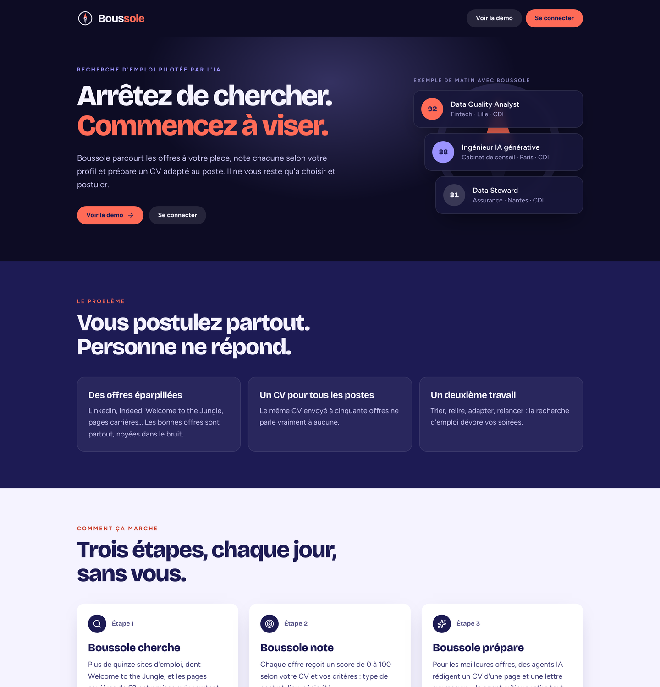
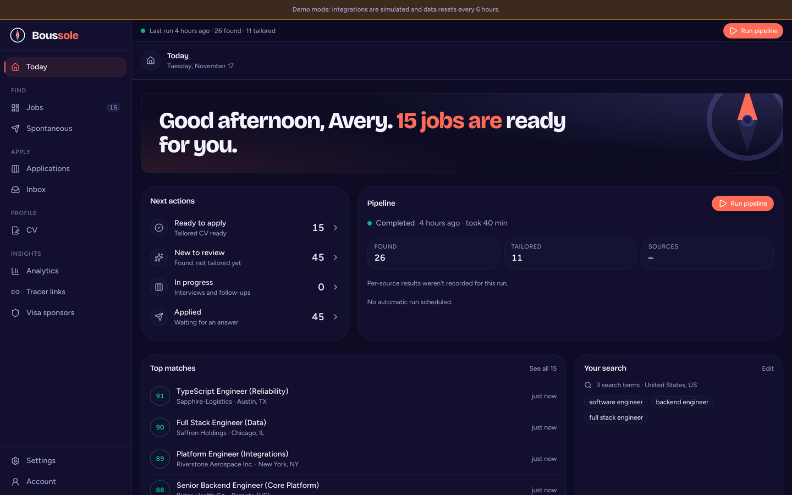
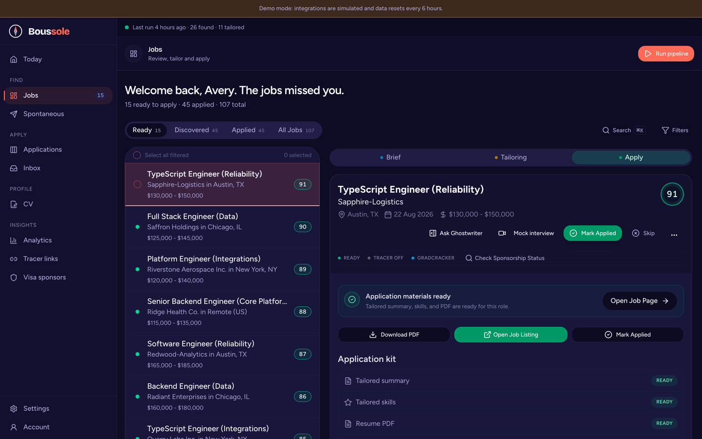
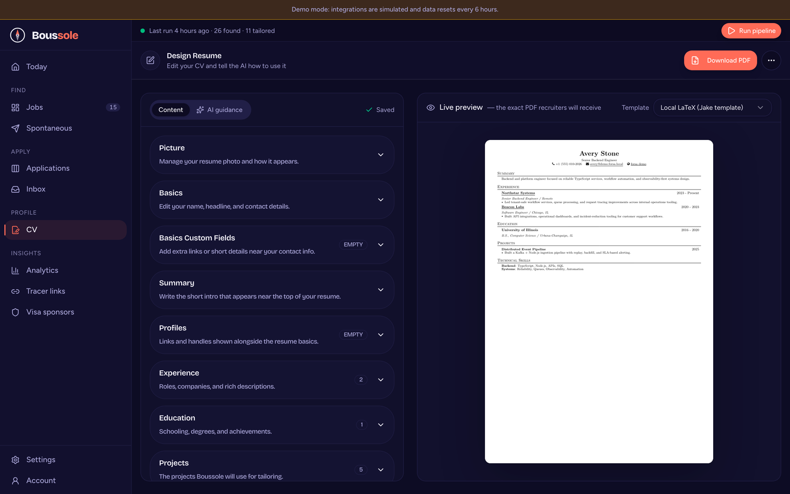
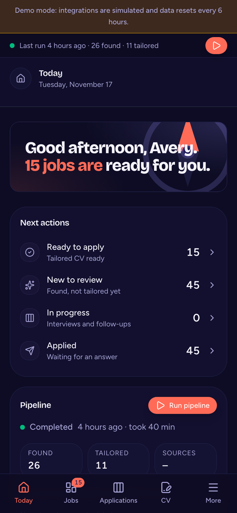

<div align="center">


# Boussole

**Arrêtez de chercher. Commencez à viser.** · *Stop searching. Start aiming.*

A self-hosted, AI-powered job-search workbench: it searches the job boards for you, scores every offer against your CV, prepares a one-page CV and cover letter for the best ones, and tracks every application. You still apply yourself.

[](./LICENSE)
[](https://www.typescriptlang.org/)
[](https://nodejs.org/)
[](https://react.dev/)
[](https://docs.langchain.com/oss/javascript/deepagents/overview)
[](https://www.anthropic.com/claude)

</div>

<div align="center">



| Today | Jobs | CV editor |
|:---:|:---:|:---:|
|  |  |  |

<sub>Screenshots from demo mode: every name, company and CV is fictional.</sub>

</div>

---

## What is Boussole?

*Boussole* is French for *compass*. It is a job-search workbench you run on your own machine (it started life as Forsa, which is why some environment variables and package names still say `forsa`).

Every day it:

1. **Searches** Welcome to the Jungle, the career pages of 62 companies hiring in France, LinkedIn, Indeed, Glassdoor and five more boards.
2. **Scores** each offer from 0 to 100 against your CV and your rules (contract type, location, seniority).
3. **Prepares** the best matches: a tailored one-page CV in your own layout (photo included), a cover letter, and a fact-check by an AI critic so nothing in them is invented.
4. **Tracks** each application from "applied" to offer, including recruiter emails in Gmail.

It deliberately **does not auto-apply**. Mass automated applications get flagged and hurt candidates; Boussole gives you leverage and leaves the sending to you.

---

## Features

### Today: one screen to see what's going on
Next actions (ready to apply, new to review, in progress), the last pipeline run with sources that failed, your best matches and your current search. A live bar on every page shows what the pipeline is doing right now.



### Job sources built for a French CDI search
- **Welcome to the Jungle**, read from its published job sitemaps and public job pages (robots.txt respected, no private keys).
- **Company career pages**: 62 employers across Greenhouse, Lever, Ashby, Workable, SmartRecruiters and Teamtailor (Mistral AI, Pigment, Artefact, Devoteam, Dust, Doctolib…), with a circuit breaker when a platform stops answering.
- LinkedIn, Indeed and Glassdoor (via JobSpy), Adzuna, startup.jobs, Hiring Cafe, Wellfound and Brave Search.
- Only sources that list jobs in France: UK, Australian, Indian and Danish boards were removed to keep the tool focused.

### AI scoring and tailoring
Every AI step runs on Claude (Opus, medium effort by default) through the Claude Code CLI, with your Claude subscription: **no API key**. Responses are cached, so re-runs over unchanged jobs cost nothing.

### LangChain Deep Agents
An agent team prepares an application pack for any job: a **job analyst**, then a **CV tailor** and a **cover-letter writer** in parallel, then a **critic** that checks every claim against the CV and removes what it can't prove. A **preference learner** turns your apply/skip decisions into long-term memory. It runs on a custom LangChain chat model (`ChatClaudeCli`) with JSON tool calling, and memory is stored per workspace in SQLite.

### CV editor with AI guidance
Edit your CV in the browser with a live PDF preview. Every CV prints in one Boussole layout: one A4 page, round photo, indigo section titles over coral rules, aligned skills and a "Stack:" line under each role. Keep language versions (FR/EN/DE/ES); jobs automatically use the matching one. For each section, tell the AI to tailor it or keep it word for word, add notes, and mark sections private so they are never sent to a model.

<br clear="right" />

### And also
Kanban board for applications, a Gmail tracking inbox, AI video mock interviews grounded in the job and your CV, analytics, tracer links, and a French landing page with a demo mode.

---

## Architecture

```
boussole/
├── orchestrator/            # Express API + React/Vite client + SQLite (Drizzle)
│   └── src/server/services/agents/   # LangChain Deep Agents layer
├── shared/                  # Types, settings registry, shared helpers
├── extractors/              # 8 source workspaces covering 10 job sources
│   ├── companyats/          # Greenhouse, Lever, Ashby, Workable, SmartRecruiters, Teamtailor
│   ├── wttj/                # Welcome to the Jungle via sitemaps
│   ├── jobspy/              # LinkedIn, Indeed, Glassdoor
│   └── …
└── docs-site/               # Docusaurus documentation
```

The orchestrator runs each source, reads progress over a `FORSA_PROGRESS` stdout protocol, scores and tailors with the configured model, and stores everything in SQLite. The React client talks to a typed REST API and receives live updates over Server-Sent Events.

### Design decisions

- **No auto-apply, by design.** Speed for everything except the send.
- **Sources are isolated.** One broken scraper can't crash a run; each source has its own dependencies and a uniform contract.
- **Respect the sites.** Welcome to the Jungle's search key only works from its own website and its robots.txt forbids crawling search pages, so Boussole reads the sitemaps it publishes instead, then fetches only matching offers, bounded and spaced out.
- **Agents where they add value.** The daily pipeline stays deterministic and cheap; the multi-agent chain is reserved for preparing an application, where a critic pass pays for itself.
- **A CLI-backed LangChain model.** LangChain's Claude integration needs an API key; wrapping the Claude Code CLI as a chat model lets the same agents run on a personal subscription, and swapping in an API model is a one-line change.
- **Privacy by default.** Models receive an AI view of the CV without email, phone or street address; private sections never leave the machine.
- **Multi-tenant from the ground up.** Settings, caches, agent memory and runs are scoped per workspace.
- **Safe to expose.** Sign-in throttling (`429` with `Retry-After`), security headers, closed CORS, and a tunnel launcher that refuses weak passwords.

---

## Tech stack

| Layer | Technology |
|-------|-----------|
| **Frontend** | React 19, Vite, Tailwind CSS v4, TanStack Query, Radix UI |
| **Backend** | Node.js 22, Express, TypeScript 5 |
| **AI** | Claude Opus via the Claude Code CLI · LangChain Deep Agents + LangGraph |
| **Data** | SQLite via better-sqlite3 + Drizzle ORM |
| **Documents** | Structured JSON CV → LaTeX (Tectonic) → one-page PDF |
| **Scraping** | Playwright / Camoufox, public ATS APIs, sitemaps |
| **Quality** | Vitest (1,600+ tests), Biome, Knip, GitHub Actions |
| **Packaging** | npm workspaces, Docker + Docker Compose |

---

## Quick start

**Docker:**

```bash
git clone https://github.com/dhia-rek/boussole.git
cd boussole
cp .env.example .env
docker compose up -d
```

Open `http://localhost:3005` and follow the onboarding.

**Local development:**

```bash
git clone https://github.com/dhia-rek/boussole.git
cd boussole
npm ci
cp .env.example .env
npm --workspace orchestrator run dev
```

API at `http://localhost:3001`, web app at `http://localhost:5173`. `dev` applies pending database migrations on every start.

**Try the demo:** start the server with `DEMO_MODE=true` for a workspace filled with fictional jobs and a fictional CV that resets every few hours.

**Open it from your phone:** `orchestrator/scripts/share.sh` publishes your instance through a Cloudflare tunnel after checking that no account uses an easy password. See *Open Boussole from Anywhere* in the docs.

---

## Configuration

Copy `.env.example` to `.env`; everything is optional unless a feature needs it.

| Variable | Used for | Description |
|----------|----------|-------------|
| `MODEL` | AI features | Claude model alias plus effort, default `opus:medium`. |
| `CLAUDE_CODE_OAUTH_TOKEN` | AI on a server | From `claude setup-token`; on your own computer, running `claude` once is enough. |
| `GMAIL_OAUTH_CLIENT_ID` / `GMAIL_OAUTH_CLIENT_SECRET` | Tracking inbox | Gmail OAuth credentials. |
| `ADZUNA_APP_ID` / `ADZUNA_APP_KEY` | Adzuna source | Adzuna developer credentials. |
| `FORSA_CORS_ORIGINS` | Separate front end | Origins allowed to call the API cross-site (closed by default). |
| `DEMO_MODE` | Public demo | Fictional data, simulated integrations, periodic reset. |

See [`.env.example`](./.env.example) for the full annotated list.

---

## Documentation

Run `npm run docs:dev` and open `http://localhost:3006`, or read the Markdown under `docs-site/docs/`: Today and navigation, job sources, AI agents, CV editor, settings, sharing online, adding a source.

---

## License

Released under the [MIT License](./LICENSE).

<div align="center">

Designed and built by [Dhia Rekik](https://dhiarekik.me) · [GitHub @dhia-rek](https://github.com/dhia-rek)

</div>
