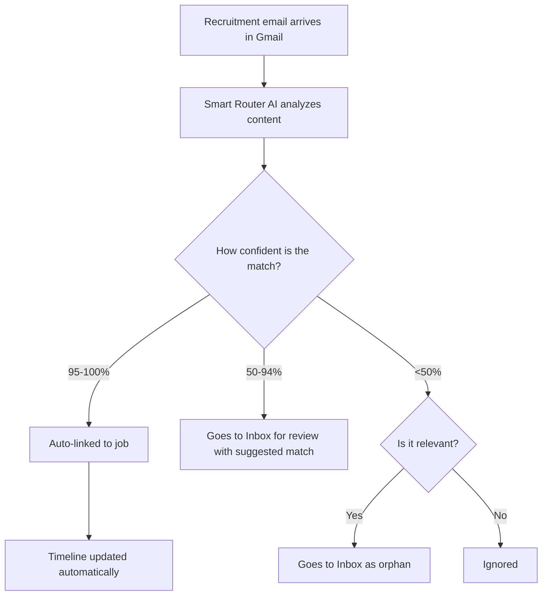

The Tracking Inbox reads your mailbox (Gmail, or iCloud Mail and other IMAP mailboxes) for replies to your applications and updates the jobs' timelines.


## Overview

1. Scans your mailbox for recruitment-related emails
2. Matches emails to tracked jobs using AI
3. Updates timeline/state when confidence is high
4. Queues uncertain matches for manual review

## Smart router flow



## Setup

### iCloud Mail (or another IMAP mailbox)

No server setup is needed: you connect with an **app-specific password**, a password Apple creates for one app, which you can delete at any time.

1. Open [account.apple.com](https://account.apple.com) and sign in.
2. In **Sign-In and Security**, open **App-Specific Passwords** and create one named "Boussole". Apple shows it as `xxxx-xxxx-xxxx-xxxx`.
3. In Boussole, open **Tracking Inbox**, choose **iCloud Mail or other (IMAP)**, enter your iCloud address and the password, then click **Connect**. Boussole signs in once to check it.
4. Click **Sync**.

For another provider, enter your address: the form then asks for the IMAP server and port (usually `993`), for example `imap.example.com`. Boussole connects with TLS only, and only to public mail servers.

What a sync does:

- Reads the sender and subject of your inbox messages from the last 90 days (2,000 most recent at most); it never sends, moves, deletes or marks email as read.
- Keeps the ones that look like job emails: application and interview subjects in English and French ("Votre candidature", "Entretien"…), recruiting senders and hiring tools, and replies from employers you applied to. Job alerts and newsletters are left out.
- Downloads only those (up to 100 per sync, text only, attachments cut off) and sorts them with your AI account, like Gmail. Emails already sorted are not sent again.

**Disconnect** deletes the stored password. You can also delete the app-specific password on [account.apple.com](https://account.apple.com).

### Gmail

#### Prerequisites

1. Gmail account with application emails
2. Google OAuth credentials

#### Configure OAuth

Set:

```bash
GMAIL_OAUTH_CLIENT_ID=your-client-id.apps.googleusercontent.com
GMAIL_OAUTH_CLIENT_SECRET=your-client-secret
GMAIL_OAUTH_REDIRECT_URI=https://your-domain.com/oauth/gmail/callback
```

Then connect in UI via **Tracking Inbox → Connect Gmail**.

Until these are set, **Tracking Inbox** shows "Gmail isn't set up on this Boussole yet" with the three setup steps and the exact redirect URI to register in Google Cloud, and **Connect** stays disabled. Meanwhile, track replies by hand on the [Applications board](/docs/features/in-progress-board).

Detailed setup guide:

- [Gmail OAuth Setup](/docs/getting-started/gmail-oauth-setup)

## Using the inbox

- Review pending items in Tracking Inbox
- Approve to link/update timeline
- Ignore to mark non-relevant

## Job emails tab

Open **Job → Emails** to review captured messages already linked to that job.

The tab is read-only. It shows stored metadata only: sender, subject, received
time, snippet, processing status, message type, match confidence, account label,
and a Gmail thread link when the stored message includes a Gmail thread ID.

It does not store full email bodies, re-fetch from Gmail, or expose review
actions. Use **Tracking Inbox** for approve/ignore decisions.

Confidence interpretation:

- `95-100%`: auto-processed
- `50-94%`: pending review with suggestion
- `<50%`: pending review as orphan/ignored

## Privacy and security

- iCloud and IMAP: read-only access to the inbox; the app-specific password is stored on your Boussole and never shown again or sent to the browser; only emails that look job-related are downloaded and sent to your AI account.
- Gmail scope requested: `gmail.readonly`
- Full scope: `https://www.googleapis.com/auth/gmail.readonly`
- Minimal metadata sent for matching
- Email data stays local in your instance

## API reference

| Method | Endpoint                                  | Description           |
| ------ | ----------------------------------------- | --------------------- |
| GET    | `/api/post-application/inbox`             | List pending messages |
| POST   | `/api/post-application/inbox/:id/approve` | Approve message       |
| POST   | `/api/post-application/inbox/:id/deny`    | Ignore message        |
| GET    | `/api/post-application/runs`              | List sync runs        |
| GET    | `/api/jobs/:id/emails?limit=100`          | List job-linked email metadata |
| GET    | `/api/post-application/providers/gmail/oauth/start` | Start OAuth flow |
| POST   | `/api/post-application/providers/gmail/oauth/exchange` | Exchange OAuth code |
| POST   | `/api/post-application/providers/imap/actions/connect` | Connect an IMAP mailbox: `{"payload": {"email", "appPassword", "host"?, "port"?}}` |
| POST   | `/api/post-application/providers/{gmail,imap}/actions/{status,sync,disconnect}` | Status, sync, disconnect |

## Common issues

- iCloud: "The mail server refused the sign-in": use an app-specific password, not your Apple Account password, and check the address. A password deleted on account.apple.com stops working at once: create a new one and connect again.
- iCloud: a job email was not picked up: its subject and sender didn't look like a job email. Link it by hand from the job's timeline.
- No refresh token: disconnect and reconnect Gmail.
- Emails not appearing: check runs, OAuth config, and recruitment subjects.
- Wrong matches: expected in lower-confidence buckets; use manual review.
