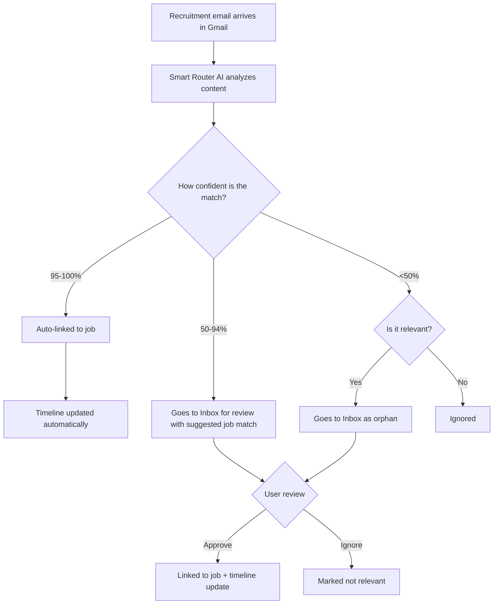

The easiest way to run Boussole is via Docker Compose. The app is self-configuring and guides you through setup on first launch.

## Prerequisites

- Docker Desktop or Docker Engine + Compose v2

## 1) Start the stack

No environment variables are required to boot:

```bash
docker compose up -d
```

This pulls the pre-built image from GHCR and starts the API, UI, and scrapers in one container.

To build locally instead:

```bash
docker compose up -d --build
```

If GitHub rate limits the Camoufox download during local builds, set an
optional `GITHUB_TOKEN` in your shell or `.env` first:

```bash
echo "GITHUB_TOKEN=ghp_your_token_here" >> .env
docker compose up -d --build
```

Boussole passes this token to the Docker build as a BuildKit secret only for the
Camoufox download step. It is not stored in the runtime container
environment.

## 2) Access the app and onboard

Open:

- **Dashboard**: `http://localhost:3005`

On the first visit, create the first username/password account. It becomes the system admin and owns the initial private workspace. The onboarding wizard then walks through three steps:

1. **Connect your AI**: sign in with your Claude or ChatGPT account and pick the model (see [AI Account](/docs/features/ai-account)). The owner's workspace can also use the server's own Claude login (`claude` once on the host, or `CLAUDE_CODE_OAUTH_TOKEN` from `claude setup-token` in Docker or on a server).
2. **Import your current CV**: upload a PDF or DOCX. Your AI account reads it and creates your CV in the CV editor.
3. **Search terms**: Boussole generates a first list of job-title search terms from your CV. Edit or regenerate them before saving.

Settings and user accounts are saved to the local database. If you are upgrading an older single-user install, Boussole migrates existing rows into one default private workspace. When `BASIC_AUTH_USER` and `BASIC_AUTH_PASSWORD` are present during that migration, they seed the first system admin account; otherwise the sign-in screen requires first-run setup before private APIs are usable.

System admins can create more users from **Settings → Environment & Workspaces**. Each created user receives a separate private workspace with isolated jobs, settings, resumes, integrations, PDFs, pipeline runs, chat, analytics, and post-application data.

## Gmail OAuth (Tracking Inbox)

If you want Gmail integration, configure OAuth credentials.

### 1) Create Google OAuth credentials

In Google Cloud:

1. Configure OAuth consent screen.
2. Enable Gmail API.
3. Create OAuth client ID (`Web application`).
4. Add redirect URI:
  - `http://localhost:3005/oauth/gmail/callback`
  - Or your production URL, for example `https://your-domain.com/oauth/gmail/callback`

### 2) Configure environment variables

- `GMAIL_OAUTH_CLIENT_ID` (required)
- `GMAIL_OAUTH_CLIENT_SECRET` (required)
- `GMAIL_OAUTH_REDIRECT_URI` (optional, recommended in production)

### 3) Restart and connect

- Restart container
- Open Tracking Inbox and click **Connect Gmail**

For a full step-by-step setup, exact scope requirements, and troubleshooting, see:

- [Gmail OAuth Setup](/docs/getting-started/gmail-oauth-setup)

## Email-to-job matching overview



## Persistent data

`./data` bind-mount stores:

- SQLite DB: `data/jobs.db`
- Generated PDFs: `data/pdfs/`
- Cloudflare challenge cookies: `data/cloudflare-cookies/`

## Public demo mode

Set `DEMO_MODE=true` for sandbox deployments.

Behavior in demo mode:

- Anonymous read-only access to the seeded demo workspace
- Works locally: browsing/filtering/viewing timelines
- Simulated: pipeline run/summarize/process/rescore/pdf/apply
- Blocked: settings writes, DB clear, backups
- Disabled: first-run account setup
- Auto-reset: every 6 hours

## Updating

```bash
git pull
docker compose pull
docker compose up -d
```

## PDF rendering

Boussole renders every CV locally with LaTeX and `tectonic`, in one layout (see [CV Editor](/docs/features/design-resume)).

- The Docker image installs `tectonic` for you.
- For non-Docker local runs, install `tectonic` yourself and optionally set `TECTONIC_BIN` if it is not on your `PATH`.
- The first render downloads the LaTeX packages it needs, so it takes longer than the next ones.
